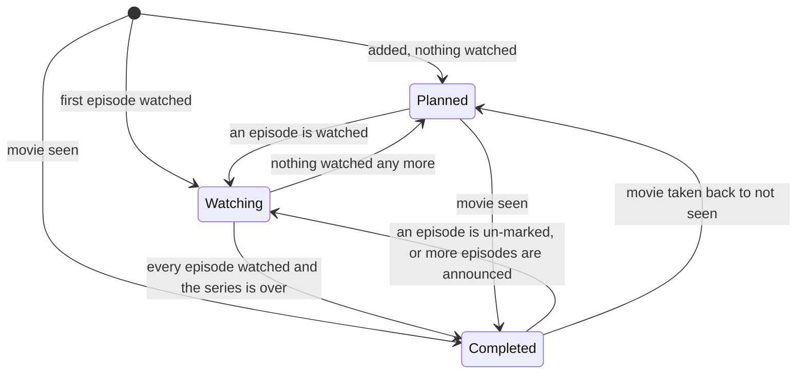

# Library status

How a movie or series gets its status in the library (`planned`, `watching`,
`paused`, `completed`, `dropped`), and when that status follows what you watch.

This is the normative description. The code is in
[`src-tauri/src/library/status.rs`](../src-tauri/src/library/status.rs): one pure
function (`decide`) holds every rule, and everything that can move a status goes
through it. If the two disagree, fix the code or this page in the same change.

## The idea

A status has two parts:

- **the status itself** — one of the five values;
- **its origin** — `auto` or `manual` (`library_items.status_origin`).

An **automatic** status is not a decision, it is a reading: it always says what
the viewing implies, and is recomputed whenever the viewing changes. A
**manual** status is a decision you took: it stays as it is, with two kinds of
exception that both follow from watching (see [Manual statuses](#manual-statuses)).

New titles are manual when you add them (a plain « add to library » is
`planned`, chosen by you), and automatic when watching creates them.
« **Automatic** » in the library editor gives a manual status back to the
viewing.

## What a status is derived from

Only these facts, never another status:

| Title  | Facts                                                                                                                                                                                       |
| ------ | ------------------------------------------------------------------------------------------------------------------------------------------------------------------------------------------- |
| Movie  | is it **seen** (`seen_movies`)                                                                                                                                                              |
| Series | **watched** regular episodes (`episode_progress`, specials excluded), TMDB's **total** number of episodes when known, TMDB's **series status** (`Ended`, `Canceled`, `Returning Series`, …) |

The **derived status** (`derived_status`):

| Title  | Facts                                                                 | Derived status |
| ------ | --------------------------------------------------------------------- | -------------- |
| Movie  | seen                                                                  | `completed`    |
| Movie  | not seen                                                              | `planned`      |
| Series | nothing watched                                                       | `planned`      |
| Series | something watched                                                     | `watching`     |
| Series | every episode watched **and** the series is over (`Ended`/`Canceled`) | `completed`    |

A series that is only caught up while still airing stays `watching`: `completed`
would be wrong the moment the next episode is announced. An unknown total or an
unknown status never completes a series. Specials (season 0) are not counted,
because TMDB's total does not include them.

## When it is reconsidered

Four triggers (`StatusTrigger`):

| Trigger       | Comes from                                                                                                                      |
| ------------- | ------------------------------------------------------------------------------------------------------------------------------- |
| **Watched**   | an episode, season, series or movie marked watched (including the TV Time import)                                               |
| **Unwatched** | an episode, season, series or movie marked not watched                                                                          |
| **Refreshed** | TMDB reported a new total or a new series status (a series page, the Today Hub), or a sync brought progress from another device |
| **Reset**     | « Automatic » in the library editor, or a title re-added while it already has progress                                          |

## The rules

`decide(current status + origin, facts, trigger)`:

| Current                     | Trigger              | Result                                                                                 |
| --------------------------- | -------------------- | -------------------------------------------------------------------------------------- |
| any                         | Reset                | the derived status, now automatic                                                      |
| automatic                   | any other            | the derived status — it follows the facts, **up and down**                             |
| manual                      | Unwatched            | unchanged                                                                              |
| manual `planned`            | Watched              | the derived status                                                                     |
| manual `watching`           | Watched or Refreshed | `completed` if the derived status is `completed`, else unchanged                       |
| manual `paused` / `dropped` | Watched              | `completed` if finished; else `watching` — **a resume**; nothing if nothing is watched |
| manual `paused` / `dropped` | Refreshed            | unchanged                                                                              |
| manual `completed`          | anything but Reset   | unchanged                                                                              |
| none (not in the library)   | Watched              | an entry is created with the derived status (automatic)                                |
| none                        | any other            | nothing                                                                                |

Deciding twice in a row with the same facts never changes anything the second
time (a retry or a double click cannot move a status again) — that is a unit
test (`deciding_is_idempotent`).

### Manual statuses

A manual status is a decision, and viewing alone does not undo it. Two things
still move it, because they say something clear:

- **watching moves a `planned` or `watching` entry forward** — you said « to
  watch » and then watched it, you said « watching » and then finished it;
- **watching resumes a `paused` or `dropped` series.** Picking up a show you
  put down is a clear intent, so it goes back to `watching` (or `completed` if
  that was the last episode).

Everything else — in particular un-watching and refreshes — leaves a manual
status alone. A `completed` you set yourself is never reopened, even if TMDB
announces new episodes.

## State diagram

For an **automatic** entry (arrows are labelled with the fact that causes them):

A series that is caught up and still airing stays in `Watching`; it moves to
`Completed` as soon as TMDB reports it has ended (the Today Hub brings that
report even if you never open the series).

## Dates

`started_at` and `completed_at` follow the status, the same way for a manual
edit and an automatic move:

- entering `watching` sets `started_at` if the entry has none (never cleared
  afterwards);
- entering `completed` stamps `completed_at` with the time of the watch;
- entering any other status clears `completed_at`;
- a move that keeps the status (for example « Automatic » on an entry that was
  already right) leaves both dates alone.

A watch or an un-watch also moves the entry's `updated_at` (never backwards),
even when the status stays the same: that is what « touched » means for the
undo of a TV Time import, which keeps an entry the viewer touched after the
import.

## Where each trigger comes from

| Trigger                       | Code                                                                                                                                                                                                                            |
| ----------------------------- | ------------------------------------------------------------------------------------------------------------------------------------------------------------------------------------------------------------------------------- |
| Watched / Unwatched, movie    | `progress/repository.rs` `toggle_movie_seen_with_note_impl` → `reconcile_status_impl`                                                                                                                                           |
| Watched / Unwatched, episodes | `progress/repository.rs` `apply_episodes_outcome_impl` → cache write + `reconcile_status_impl`                                                                                                                                  |
| TV Time import                | `integrations/tvtime/importer.rs` (movies, through `reconcile_status_impl`; episodes through the call above)                                                                                                                    |
| Refreshed, TMDB               | `progress/repository.rs` `refresh_tracked_series_status_impl` → `reconcile_title_impl`, written from a series page and from the Today Hub (`use-watch-next.ts`, which has just fetched TMDB's details for every started series) |
| Refreshed, sync               | `sync/service.rs` `apply_remote_changes`: every title whose viewing data a pulled batch touched is reconsidered once the batch is applied                                                                                       |
| Reset, « Automatic »          | `reset_library_status_to_auto` command → `reset_status_to_auto_impl`                                                                                                                                                            |
| Reset, re-add                 | `add_if_absent_impl` → `adopt_existing_progress_impl`                                                                                                                                                                           |

Facts come from the database, in the same transaction as the write that
changed them, and from nowhere else: `stored_facts` reads the seen movie, or the
watched regular episodes of the series with the TMDB total and status cached in
`tracked_series`. A viewing action first writes what it knows of TMDB into that
cache (the series details it holds: the episode count, never below what is
watched, and the status), then decides from the cache; a refresh writes TMDB's
word there and decides; a sync or a reset decide from whatever is stored. So a
watch and the refresh that follows it can never read two different totals and
take each other's status back.

The cached total is `0` when TMDB's count was never known (a write without a
count leaves the total as it was), and `0` reads as « unknown » — never as « as
long as what is watched », which would « complete » a series of unknown length.
The tracked-series list shows the larger of the cached total and the watched
count, so the interface never displays « 0 episodes ».

## Cloud sync

The status travels with the library entry (`status` and `statusOrigin` are in
the sync payload) and so does the viewing data. Neither side is trusted to be
consistent with the other: after a pull, every title the batch touched is
reconsidered from the progress now stored on this device. A status that changes
as a result is queued for the cloud like any local change, and the other device,
reading the same facts, reaches the same value — so devices converge instead of
overwriting each other. A manual status is not touched by a sync, except for the
forward moves watching itself makes.

## In the interface

The status field of the library editor has an **Automatic** option first. While
it is selected a line under the field says what it currently resolves to
(« Follows what you watch — currently Watching »). Saving with Automatic leaves
the status out of the saved fields (sending it would make it a manual choice)
and then asks Rust to adopt the derived status. Choosing any concrete status
makes it manual.

## Changing the rules

All rules live in `decide`, `derived_status` and `apply_set` of `status.rs`.

- Change a rule: edit `decide`, then the table above, and update the unit tests
  in `status.rs` (a table of named cases, plus one that checks
  idempotence over every status × origin × trigger) and the independent model in `library/sequence_tests.rs`, which
  restates the rules and is compared to the database after every step of random
  sequences.
- Add a trigger: add a `StatusTrigger` variant, decide what each current status
  does with it, and call `reconcile_status_impl` / `reconcile_title_impl` from
  the new code path **in the same transaction** as the write it follows.
- Never set `library_items.status` from anywhere else for an automatic reason.
  A manual edit (`upsert_impl`) is the only other writer.

Scenarios written as the viewer would describe them are in
`library/status_flow_tests.rs`; the sync scenario is in
`sync/scenario_tests.rs` (`progress_pulled_from_another_device_…`).
